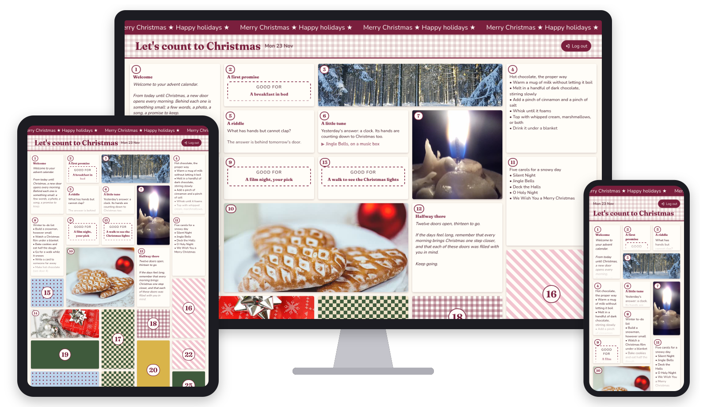

<p align="center">
  
</p>

<h1 align="center">Advent-Calendar</h1>

<p align="center">A self-hosted advent calendar with a surprise behind each door</p>

<p align="center">
  <a href="LICENSE"></a>
  <a href="https://github.com/Enoal-Fauchille-Bolle/Advent-Calendar/releases/latest"></a>
  <a href="https://github.com/Enoal-Fauchille-Bolle/Advent-Calendar/pkgs/container/advent-calendar"></a>
</p>

<p align="center">
  <a href="docs/content.md">Writing the content</a> · <a href="docs/hosting.md">Hosting</a> · <a href="docs/troubleshooting.md">Troubleshooting</a> · <a href="CONTRIBUTING.md">Contributing</a>
</p>

<picture>
  <source media="(prefers-color-scheme: dark)" srcset="docs/images/screenshot-dark.png">
  
</picture>

## Features

- **Behind a password**: the calendar opens only with a password, shared with the people it is made for.
- **A door a day**: each door opens at a set time on its day and holds a letter, a list, a voucher, photos or a voice message.
- **Nothing shows early**: the server refuses a locked door and its media, even to someone reading the page source or guessing a link.
- **Author preview**: an optional second password opens every door ahead of time, with a toolbar to open or close every door, see the calendar as a visitor does, show when each door opens and check every day's content.
- **Notifications**: an optional push notification when a door opens.
- **English or French**: set with `language` in `calendar.json`.

## Quick start

### With Docker

In an empty folder, save this as `docker-compose.yml`:

```yaml
# Advent-Calendar: https://github.com/Enoal-Fauchille-Bolle/Advent-Calendar
# Start:   docker compose up -d
# Secrets: .env next to this file, see docs/hosting.md
services:
  advent-calendar:
    image: ghcr.io/enoal-fauchille-bolle/advent-calendar:0.4.0
    restart: unless-stopped
    env_file: .env
    # To try the examples bundled in the image instead of your own content, uncomment:
    # environment:
    #   ADVENT_CONTENT_DIR: /app/examples/content
    ports:
      # Reachable from this machine only, for a reverse proxy on the same host.
      # ADVENT_BIND=0.0.0.0 in .env opens it to the network.
      - "${ADVENT_BIND:-127.0.0.1}:${ADVENT_PUBLISHED_PORT:-3000}:3000"
    volumes:
      # The surprises, read-only: the server never writes them.
      - "${ADVENT_CONTENT:-./content}:/content:ro"
      # Push subscriptions and the days already sent, when ADVENT_VAPID_PRIVATE_KEY is set.
      - state:/state
    # The image has no curl or wget, so Node itself asks /healthz.
    healthcheck:
      test:
        - CMD
        - node
        - -e
        - "fetch('http://127.0.0.1:3000/healthz').then((r) => process.exit(r.ok ? 0 : 1), () => process.exit(1))"
      interval: 30s
      timeout: 5s
      retries: 3
      start_period: 10s

volumes:
  state:
```

Next to it, write `.env` with the hash of the password and a secret for the login cookie:

```bash
printf 'ADVENT_PASSWORD_HASH=%s\nADVENT_SESSION_SECRET=%s\n' \
  "$(printf %s 'the password' | docker run --rm -i ghcr.io/enoal-fauchille-bolle/advent-calendar node dist/cli/hash-password.js)" \
  "$(openssl rand -base64 48)" > .env
```

The author password and the notifications are optional: see [Hosting](docs/hosting.md#docker).

Put the calendar in `content/` (see [Writing the content](docs/content.md)), or uncomment the `environment` lines to try the examples. Then run `docker compose up -d` and open `http://127.0.0.1:3000`.

### Without Docker

Requires Node 24 and pnpm.

```bash
pnpm install
export ADVENT_PASSWORD_HASH="$(printf %s 'test' | pnpm make-hash)"
export ADVENT_AUTHOR_PASSWORD_HASH="$(printf %s 'author' | pnpm make-hash)"
export ADVENT_SESSION_SECRET="$(openssl rand -base64 48)"
# Optional, for notifications
export ADVENT_VAPID_PRIVATE_KEY="$(pnpm make-vapid)"
export ADVENT_VAPID_SUBJECT=https://example.com
ADVENT_CONTENT_DIR=examples/content pnpm dev
```

Then open `http://127.0.0.1:3000`. `test` shows the doors as they will appear on the day; `author` opens every door.

## Documentation

- [Writing the content](docs/content.md): `calendar.json`, `day.json`, door sizes and animations.
- [Hosting](docs/hosting.md): configuration, notifications, Docker.
- [Troubleshooting](docs/troubleshooting.md): what a message in the log means, and the usual fixes.

## Development

`pnpm check` runs the types, lint, format and tests. Setup, commit rules and releases are in [CONTRIBUTING.md](CONTRIBUTING.md).

## License

MIT, see [LICENSE](LICENSE).

The fonts in `assets/fonts/`, Fraunces and Nunito, are under the SIL Open Font License 1.1: see [OFL-Fraunces.txt](assets/fonts/OFL-Fraunces.txt) and [OFL-Nunito.txt](assets/fonts/OFL-Nunito.txt).

The photos, drawings and melodies of the examples are listed in [examples/CREDITS.md](examples/CREDITS.md).
